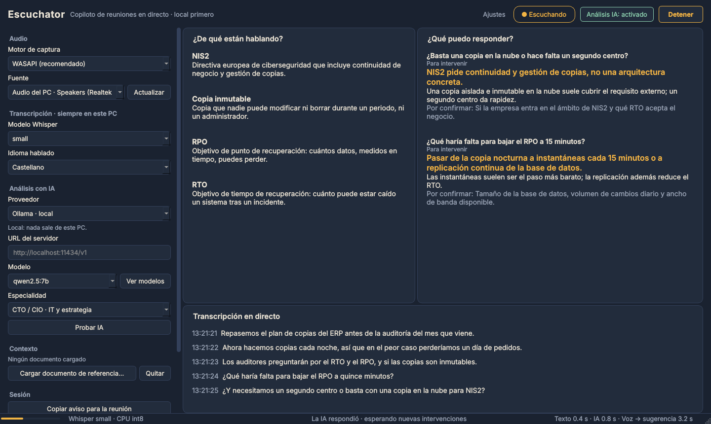

<div align="center">


# Pinganillo

**Un copiloto de reuniones en directo que funciona en tu propio ordenador.**
Escucha lo que suena en tu PC, lo transcribe en local con Whisper y, discretamente, te explica la jerga y te sugiere qué podrías responder.

[English](README.md) · [Arquitectura](docs/architecture.md) · [Decisiones de diseño](docs/decisions) · [Uso responsable](docs/responsible-use.md)



</div>

## Para qué sirve

> El pinganillo es ese auricular diminuto por el que el realizador le sopla al presentador. Seguro que conoces el gesto: el dedo en la oreja, atento a la indicación.


Estás en una llamada con un proveedor, un auditor o un cliente y empiezan a hablar de *RPO*, *copias inmutables* y *NIS2*. Asientes. Pinganillo está al lado de la llamada y, unos segundos después, te muestra qué significan esos términos y te propone una respuesta.

- **La voz nunca sale de tu PC.** La transcripción siempre es local (faster-whisper, int8 en CPU).
- **La IA la eliges tú.** Totalmente local con [Ollama](https://ollama.com) o LM Studio, cualquier servidor compatible con OpenAI, tu plan de ChatGPT o sin IA.
- **No se une ningún bot a la reunión.** Capta la salida de tus altavoces, así que funciona con Teams, Meet, Zoom o un vídeo de YouTube.
- **Honesto por diseño.** Sin modo oculto, con un aviso la primera vez y un mensaje listo para avisar a los participantes con un clic. Ver [uso responsable](docs/responsible-use.md).

## Empezar

**Pruébalo sin audio, modelos ni cuentas:** el modo demo usa el sistema real con una reunión simulada.

```bash
pip install git+https://github.com/grebuch/pinganillo
pinganillo --demo --lang es
```

**Úsalo de verdad en Windows 10/11:**

1. Instala [Python 3.12](https://www.python.org/downloads/) (64 bits) y descarga o clona este repositorio.
2. Haz doble clic en `run-windows.bat`. La primera vez crea un entorno privado e instala las dependencias; después arranca directamente.
3. Elige la salida en la que escuchas la llamada (por ejemplo *Audio del PC · Auriculares*), pulsa **Empezar a escuchar** y reproduce algo de voz.
4. Opcional: instala [Ollama](https://ollama.com), ejecuta `ollama pull qwen2.5:7b`, elige *Ollama · local* como proveedor y activa el **Análisis IA**.

Si no aparece texto, ejecuta `diagnose-windows.bat` con un vídeo con voz reproduciéndose. Comprueba la captura, el nivel de señal y Whisper, y genera un informe breve sin audio ni texto.

## Proveedores de IA

| Proveedor | Adónde va el texto | Coste | Notas |
|---|---|---|---|
| Solo transcripción | A ningún sitio | Gratis | Los paneles de conceptos y respuestas quedan vacíos |
| Ollama / LM Studio | Tu PC | Gratis | Sin conexión tras descargar el modelo |
| Servidor compatible con OpenAI | Ese servidor | Depende | llama.cpp, vLLM, Groq, OpenRouter, Mistral… |
| Plan de ChatGPT | OpenAI | Consume los límites de tu plan | [Sign in with ChatGPT](https://developers.openai.com/siwc/quickstart), en versión preliminar y solo para planes compatibles |
| API de OpenAI | OpenAI | Se paga por uso | Pide confirmación en cada sesión |

Con ningún proveedor se sube el audio.

## Cómo funciona

Captura, transcripción y análisis funcionan en **tres hilos conectados por colas**; la interfaz solo lee una cola de eventos. Si la IA tarda o falla, la transcripción sigue. Explicación completa (en inglés) en [docs/architecture.md](docs/architecture.md), y el porqué de cada decisión en [docs/decisions](docs/decisions).

Algunos problemas resueltos:

- **El silencio cortaba la captura.** Windows no envía ningún paquete por la salida mientras no suena nada; ahora ese tiempo se rellena con silencio digital.
- **Peticiones pequeñas a propósito.** Del documento de referencia solo se envían los fragmentos relevantes (búsqueda BM25), no el documento entero.
- **Esperas con límite y sin peticiones duplicadas**, y las respuestas tardías se descartan.
- **Inyección de instrucciones:** lo que se dice en la reunión se trata como datos, nunca como órdenes.
- **Latencia medida:** la barra de estado muestra cuánto tarda la voz en convertirse en texto y en sugerencia.

## Limitaciones

- Pensado sobre todo para Windows. macOS y Linux están abiertos a contribuciones.
- Una sola fuente a la vez: altavoces *o* micrófono.
- El corte de los bloques se basa en el volumen y puede partir una frase.
- Las sugerencias llegan segundos después de la pregunta y pueden equivocarse. Compruébalas.

Los próximos pasos están en la [hoja de ruta](docs/roadmap.md) (en inglés); la próxima versión se centra en reducir el retraso.

## Desarrollo

```bash
pip install -e ".[dev]"
pytest
ruff check . && ruff format --check .
python -m pinganillo --demo
```

Detalles en [CONTRIBUTING.md](CONTRIBUTING.md).

## Cómo se ha hecho

Pinganillo empezó como un prototipo para Windows llamado *Escuchator*, escrito con ayuda de ChatGPT. Después se reestructuró, se probó y se documentó cambio a cambio; el [historial](https://github.com/grebuch/pinganillo/commits/main) muestra ese camino.

## Licencia

[MIT](LICENSE). Sin relación con OpenAI, Microsoft ni los autores de Whisper.
