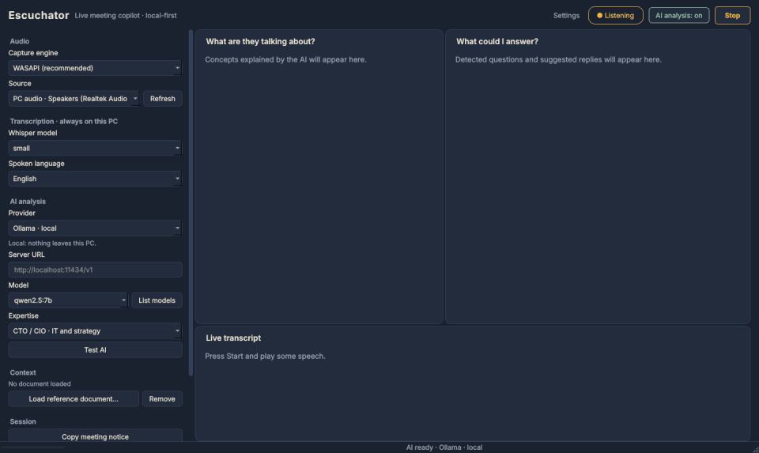
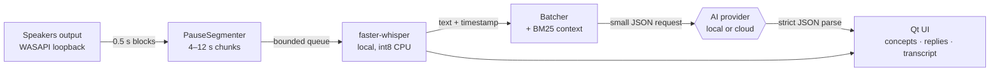

<div align="center">


# Pinganillo

**A live meeting copilot that runs on your own computer.**
It listens to what your PC plays, transcribes it locally with Whisper, and quietly explains the jargon and suggests what you could answer.

[](https://github.com/grebuch/pinganillo/actions/workflows/ci.yml)
[](LICENSE)


[Español](README.es.md) · [Architecture](docs/architecture.md) · [Design decisions](docs/decisions) · [Responsible use](docs/responsible-use.md)



</div>

## Why

> In Spanish TV, the *pinganillo* is the tiny earpiece through which the control room whispers to a presenter. You have seen the gesture: a finger pressed to the ear, listening for the cue.


You are in a call with a vendor, an auditor or a client, and they start talking about *RPO*, *immutable backups* and *NIS2*. You nod. Pinganillo sits next to the call and, a few seconds later, shows you what those terms mean and drafts a reply you could say.

- **Speech never leaves your PC.** Transcription always runs locally (faster-whisper, int8 on CPU).
- **The AI is your choice.** Fully local with [Ollama](https://ollama.com) or LM Studio, any OpenAI-compatible server, your ChatGPT plan, or no AI at all.
- **No bot joins the meeting.** It captures your speakers' output, so it works with Teams, Meet, Zoom or a YouTube video.
- **Honest by design.** No stealth mode, a first-run notice and a one-click message to tell participants. See [responsible use](docs/responsible-use.md).

## Quick start

**Try it without audio, models or accounts:** the demo mode drives the real pipeline with a scripted meeting.

```bash
pip install git+https://github.com/grebuch/pinganillo
pinganillo --demo
```

**Use it for real on Windows 10/11:**

1. Install [Python 3.12](https://www.python.org/downloads/) (64-bit; 3.11 and 3.13 also work, from python.org, pyenv-win or PATH), then clone or download this repository.
2. Double-click `run-windows.bat`. The first run creates a private environment and installs dependencies; later runs start straight away.
3. Pick the output you hear your call on (for example *PC audio · Headphones*), press **Start listening** and play some speech.
4. Optional: install [Ollama](https://ollama.com), run `ollama pull qwen2.5:7b`, choose *Ollama · local* as the provider and switch **AI analysis** on.

If no text appears, run `diagnose-windows.bat` while a video with speech is playing. It checks capture, signal level and Whisper, and writes a short report without audio or text.

## AI providers

| Provider | Where the text goes | Cost | Notes |
|---|---|---|---|
| Transcription only | Nowhere | Free | Concept and reply panels stay empty |
| Ollama / LM Studio | Your PC | Free | Fully offline after the model download |
| Any OpenAI-compatible server | That server | Depends | llama.cpp, vLLM, Groq, OpenRouter, Mistral… |
| ChatGPT plan | OpenAI | Uses your plan's limits | [Sign in with ChatGPT](https://developers.openai.com/siwc/quickstart), preview, eligible plans only |
| OpenAI API | OpenAI | Billed per token | Asks for confirmation before each session |

Audio is never uploaded with any provider.

## How it works



Capture, transcription and analysis run in **three threads connected by queues**; the UI only reads an event queue. A slow or failing AI never stops the transcript. The full walkthrough is in [docs/architecture.md](docs/architecture.md).

## Engineering notes

Some of the problems this project had to solve. Each one has a short decision record in [`docs/decisions`](docs/decisions).

- **Silent outputs used to stop the capture.** A WASAPI loopback stream sends *no packets at all* while nothing plays, so a quiet moment looked like a dead device. The recorder now pads elapsed wall-clock time with digital silence and only fails if the stream really stopped ([ADR 0008](docs/decisions/0008-pad-wasapi-loopback-silence.md)).
- **Opposite-phase channels.** Some headsets expose a channel with inverted phase, and averaging *L* and *−L* gives silence. The down-mix detects it and keeps the loudest channel.
- **Small requests on purpose.** The prototype sent the whole reference document (up to ~10k tokens) several times a minute. Now only the BM25-ranked passages that match the current speech are sent, capped at 2,500 characters, with no embedding model and no extra dependency ([ADR 0005](docs/decisions/0005-bm25-context-instead-of-whole-document.md)).
- **Timeouts without lying.** Python cannot safely kill a thread blocked on a socket. A timeout means "stop waiting", a second request is refused while the first is still open, and late answers are discarded by a generation counter ([ADR 0004](docs/decisions/0004-deadline-without-cancellation.md)).
- **Prompt injection.** Anything said in the meeting is untrusted input; someone can say "ignore your instructions". The prompt treats it as data, the output is parsed strictly, and the app only displays text, never acts on it.
- **OAuth done properly.** Authorization code + PKCE over a loopback listener, ID token verified against the JWKS (signature, issuer, audience, nonce, expiry), scope checked, tokens kept in memory only.
- **Measured, not guessed.** Every chunk is timestamped; the status bar shows p50 latency for speech → text, model time and speech → suggestion.

## Benchmark

`pinganillo-bench` cuts a WAV file exactly like the live app, transcribes it with the real model, replays the timeline as if the audio were arriving live (including queueing when the CPU falls behind) and reports real-time factor, latency percentiles and word error rate:

```bash
pinganillo-bench meeting.wav --model small --language es --reference meeting.txt --json result.json
```

Method and results: [docs/benchmarks.md](docs/benchmarks.md). Results from other machines are welcome as issues.

## Limitations

- Windows is the main target. The SoundCard engine is a fallback; macOS and Linux capture are open for contributions.
- One source at a time: your speakers *or* your microphone, not both mixed.
- Chunking is a volume heuristic, not linguistic segmentation; it can split a sentence.
- Suggestions arrive seconds after the question. They are better at explaining concepts than at real-time repartee.
- Suggestions can be wrong. The model is told not to invent facts, but verify before relying on them.

## Development

```bash
git clone https://github.com/grebuch/pinganillo && cd pinganillo
python -m venv .venv && . .venv/bin/activate      # Windows: .venv\Scripts\activate
pip install -e ".[dev]"
pytest                                            # no audio hardware, model or network needed
ruff check . && ruff format --check .
python -m pinganillo --demo
```

See [CONTRIBUTING.md](CONTRIBUTING.md) for the project layout, how to add a language and good first issues.

## How this was built

Pinganillo started as a Windows prototype called *Escuchator*, written with ChatGPT's help. It was then restructured, tested and documented with Claude's help, one reviewed commit at a time; the [history](https://github.com/grebuch/pinganillo/commits/main) shows that path. The reasoning behind every design decision is written down in [`docs/decisions`](docs/decisions).

## License

[MIT](LICENSE). Not affiliated with OpenAI, Microsoft or the authors of Whisper.
