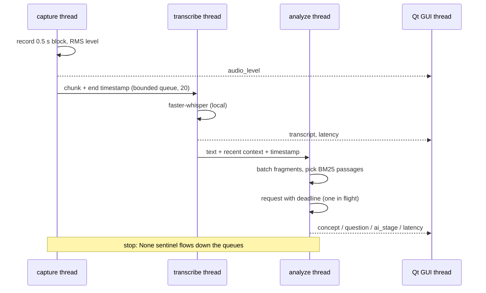

# Architecture

## The pipeline

| Module | Responsibility |
|---|---|
| `audio/wasapi.py`, `audio/devices.py` | Enumerate devices; capture at native rate, resample to 48 kHz; pad loopback silence |
| `audio/dsp.py` | RMS, phase-safe mono down-mix, polyphase resampling to Whisper's 16 kHz |
| `audio/segmenter.py` | Group 0.5 s blocks into 4–12 s chunks, cutting at pauses |
| `stt/whisper_local.py` | faster-whisper, CPU int8, VAD filter, no prompt feedback |
| `llm/knowledge.py` | Split the reference document into passages, rank them with BM25 |
| `llm/prompt.py`, `llm/parsing.py` | Instructions (untrusted-data rule) and strict JSON validation |
| `llm/analyzers.py`, `llm/providers.py` | Chat Completions backend, ChatGPT plan backend, factory |
| `llm/deadline.py` | Bounded waiting, single in-flight request |
| `auth/chatgpt.py` | Sign in with ChatGPT: PKCE, JWKS verification, refresh, revocation |
| `pipeline.py` | The three threads, events, latency telemetry |
| `ui/` | Qt window, theme; polls the event queue every 100 ms |
| `demo.py` | Scripted device, transcriber and analyzer for `--demo` |
| `bench.py` | Offline replay benchmark: RTF, latency percentiles, WER |

## Rules the code follows

1. **Worker threads never touch widgets.** They publish `(session, kind, value)` tuples; the GUI thread drains them on a timer. Background tasks (sign-in, model listing) use the same queue with `session = None`.
2. **Each stage fails on its own.** A capture error stops the session; a transcription error skips one chunk; an AI error pauses only the analysis.
3. **Back-pressure is explicit.** The audio queue is bounded. If Whisper falls behind, chunks are dropped *and counted*, and the user is told to pick a smaller model.
4. **Messages are keys, not sentences.** The pipeline emits `("ai.waiting", {"seconds": 12, "limit": 45})`; the UI translates.
5. **Stopping drains, cancelling discards.** *Stop* lets queued audio finish; closing the window also sets `cancel`.
6. **Late answers are discarded.** Pausing or swapping the AI bumps `ai_generation`; a response for an older generation is ignored.

## Latency model

For each chunk the pipeline stores the monotonic time at which its audio ended. It records:

- `stt`: chunk end → text ready (includes waiting in the queue)
- `ai`: time spent in the model request
- `e2e`: end of the oldest chunk in a batch → suggestions ready

The words at the *start* of a chunk wait for up to 12 s more before the chunk closes; that part is inherent to chunked recognition and is why `pinganillo-bench` also reports per-chunk start and end times.
